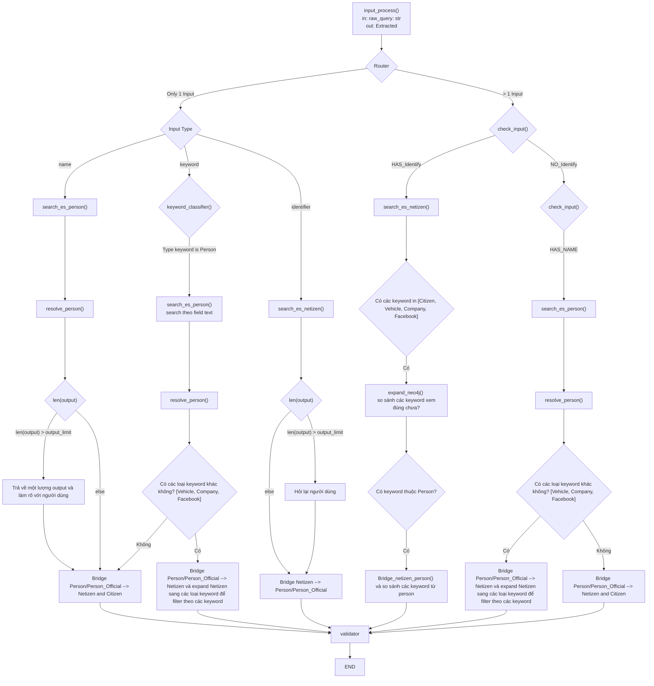
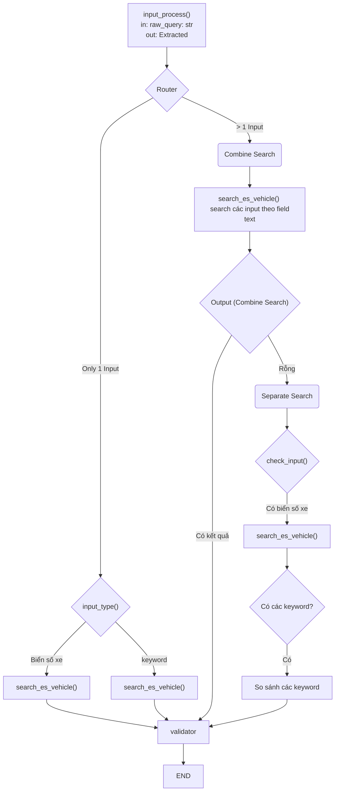
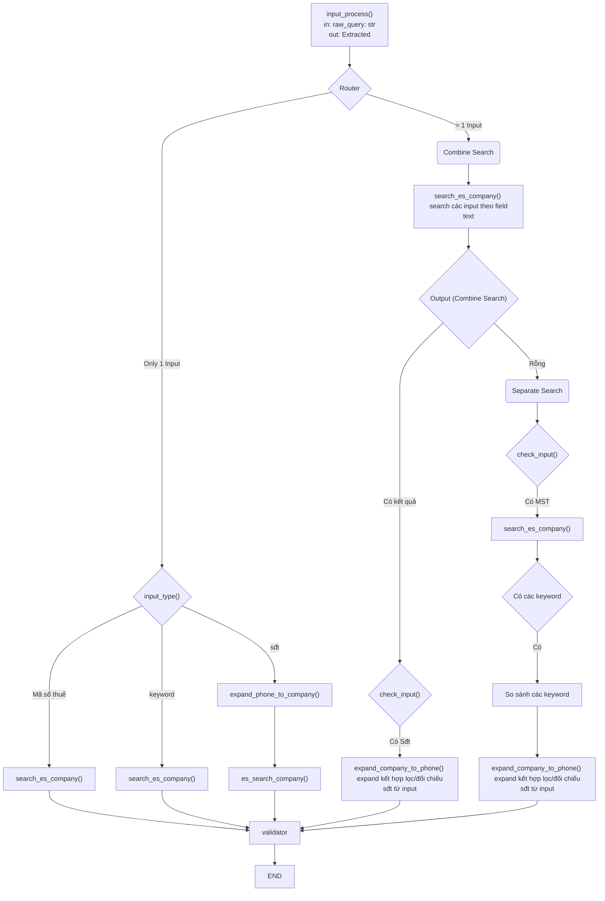
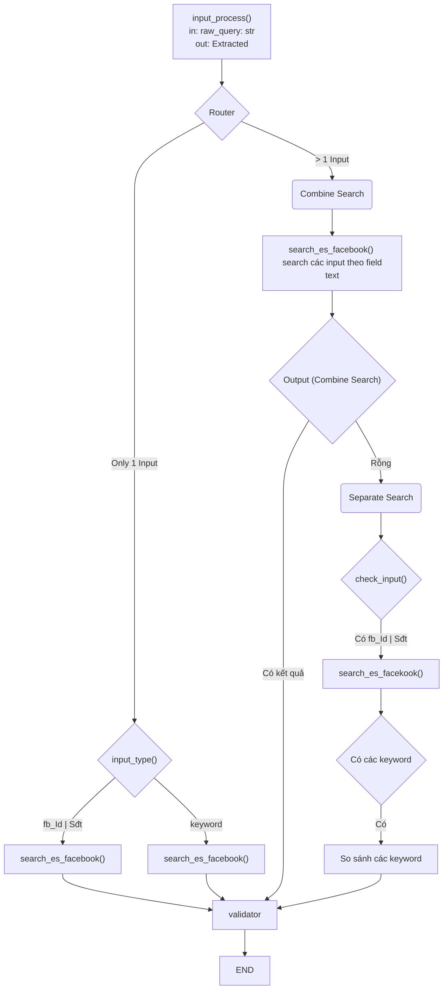
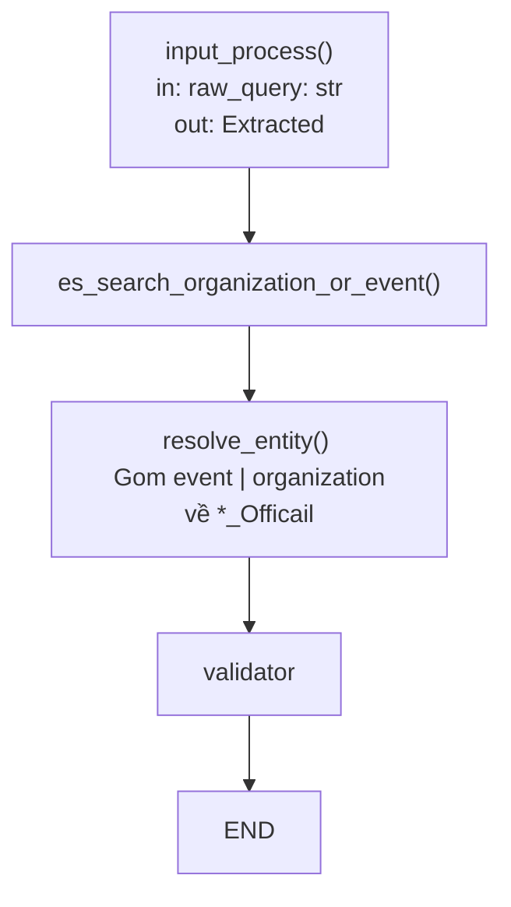
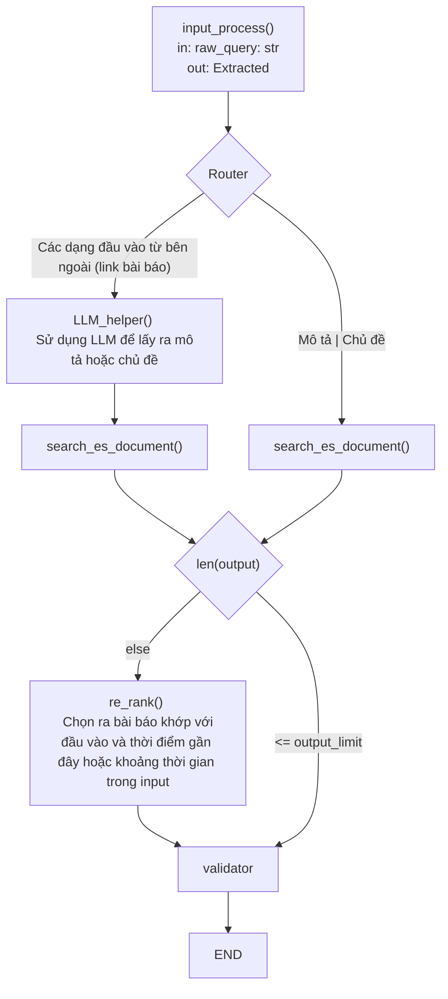
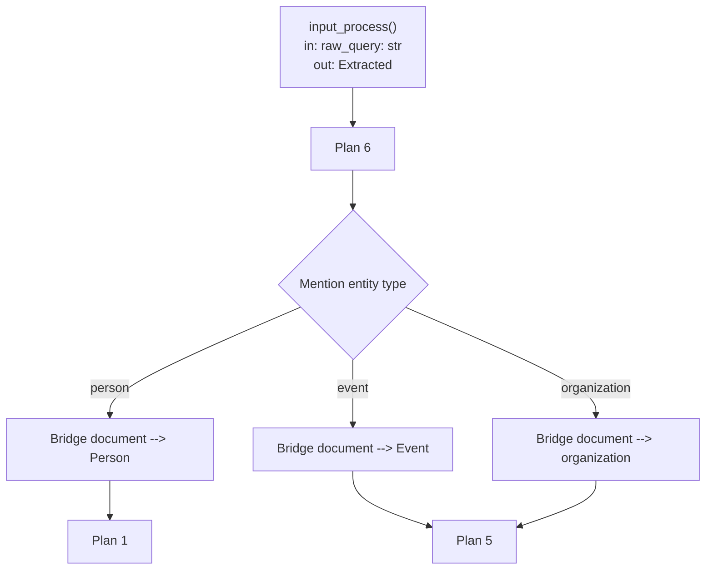
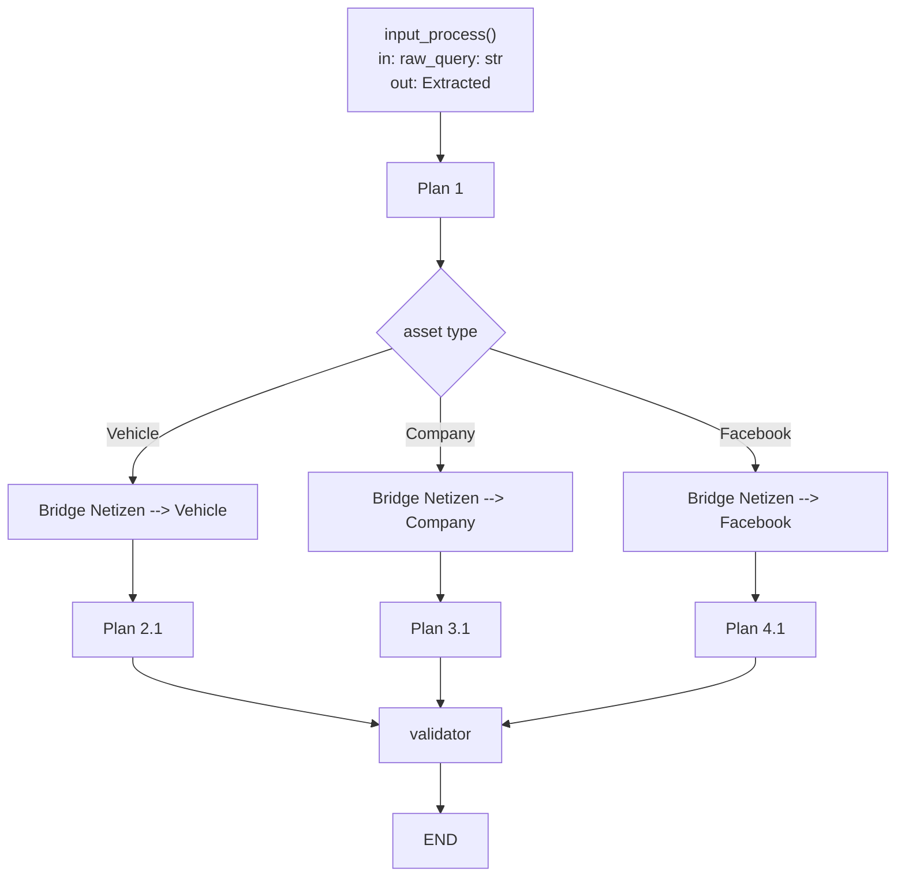
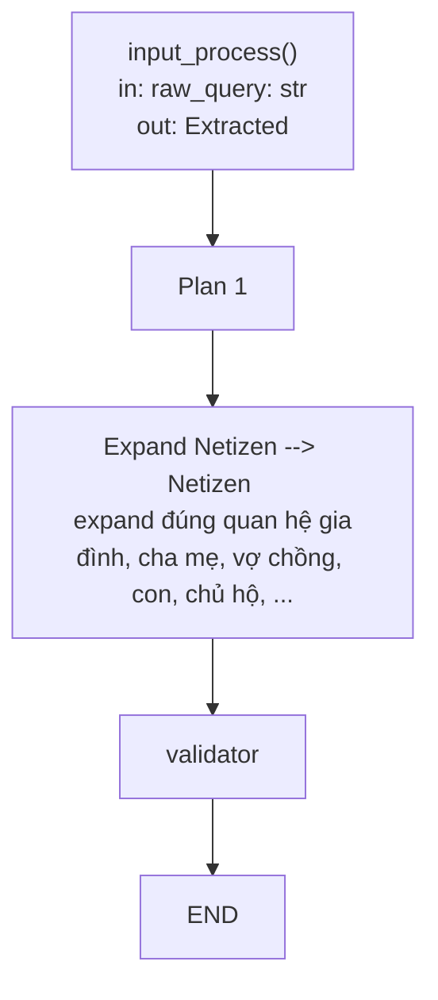
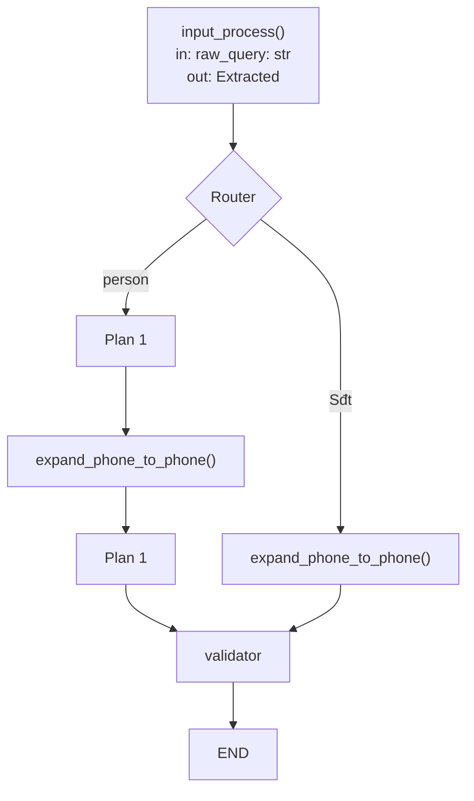

# Capabilities 

## CAP-01. Tìm thông tin về người

### Mô tả

Mục tiêu của capability này sẽ lấy ra các thông tin liên quan đến một người. Các thông tin liên quan đến một người bao gồm:
- Thông tin công khai, xuất hiện trong tài liệu/bài báo công khai
- Thông tin định danh và nhân khẩu học (Netizen và Citizen)

Ví dụ với câu hỏi: "Tìm Nguyễn Văn A quê ở Hưng Yên và đi xe Honda màu đỏ."

Với câu hỏi trên thì kỳ vọng capability trả về:
- Thông tin công khai của Nguyễn Văn A
- Thông tin định danh (CCCD, SĐT, ...) của Nguyễn Văn A (netizen)
- Thông tin nhân khẩu học (Giới tính, Tình trạng hôn nhân, quê quán, nơi ở, ...) của Nguyễn Văn A

### Plan 1

## CAP-02. Tra cứu thông tin về phương tiện (Vehicle)

### Mô tả

Mục tiêu của capability này sẽ trả lời các dạng câu hỏi sau:
- Tra cứu thông tin của xe dựa vào biển số xe hoặc các keyword liên quan đến xe

### Plan 2

Tra cứu thông tin của xe dựa vào biển số xe hoặc các keyword liên quan đến xe

## CAP-03. Tra cứu thông tin về Company

### Mô tả
Mục tiêu của capability này sẽ trả lời các dạng câu hỏi sau:
- Tra cứu thông tin của Company dựa vào mã số thuế, sđt và các keyword liên quan đến Company
- Tra cứu thông tin người đại diện công ty dựa vào mã số thuế, sđt và các keyword liên quan đến company

### Plan 3
Tra cứu thông tin của Company dựa vào mã số thuế và các keyword liên quan đến Company

## CAP-04. Tra cứu thông tin về facebook

Mục tiêu của capability này sẽ trả lời các dạng câu hỏi sau:
- Tra cứu thông tin về facebook sử dụng tên fb, sđt hoặc id (hiếm gặp)
- Tra cứu thông tin của chủ fb dựa vào thông tin fb.

### Plan 4

Tra cứu thông tin về facebook sử dụng tên fb, sđt hoặc id (hiếm gặp)

## CAP-05. Tra cứu thông tin về tổ chức/sự kiện công khai

### Mô tả
Mục tiêu của capability này là sẽ tra cứu các thông tin về tổ chức hoặc sự kiện sử dụng dữ liệu cung cấp từ câu hỏi người dùng.

### Plan 5

## CAP-06. Tra cứu thông tin về Bài báo/Tài liệu dựa vào chủ đề, mô tả

### Mô tả 

Mục tiêu của Capability này là tra cứu thông tin về bài báo hoặc tài liệu liên quan đến mô tả hoặc chủ đề được người dùng cung cấp

### Plan 6

### CAP-07. Tài liệu | Bài báo đề cập đến những ai, tổ chức, sự kiện nào?

### Mô tả

Mục tiêu của capability này là đi tìm thông tin các thực thể như person, organization và evnet được đề cập trong một bài báo cụ thể.

### Plan 7

## CAP-08. Tài sản liên kết với một người

### Mô tả

Người dùng cung cấp tên, identifier, keyword về người và hỏi về phương tiện, số điện thoại, company hoặc fb của người đó

### Plan 8

## CAP-09. Quan hệ gia đình

### Mô tả 

Người dùng cung cấp name, keyword hoặc identify về người và hỏi về quan hệ gia đình của người đó

### Plan 9

## CAP-10. Tra cứu người hoặc số điện thoại hay liên lạc với ai, số điện thoại nào?

### Mô tả

Mục tiêu của capability này là tìm một người hay liên lạc với các người khác và số điện thoại hay liên lạc với số điện thoại khác.

### Plan 10

