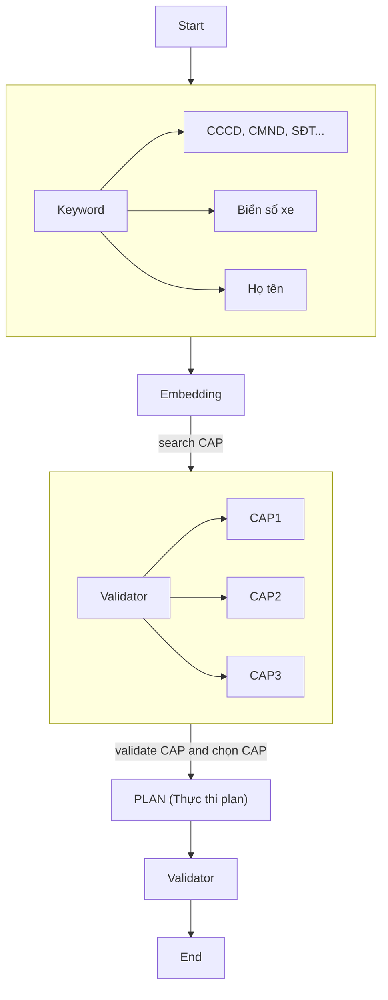
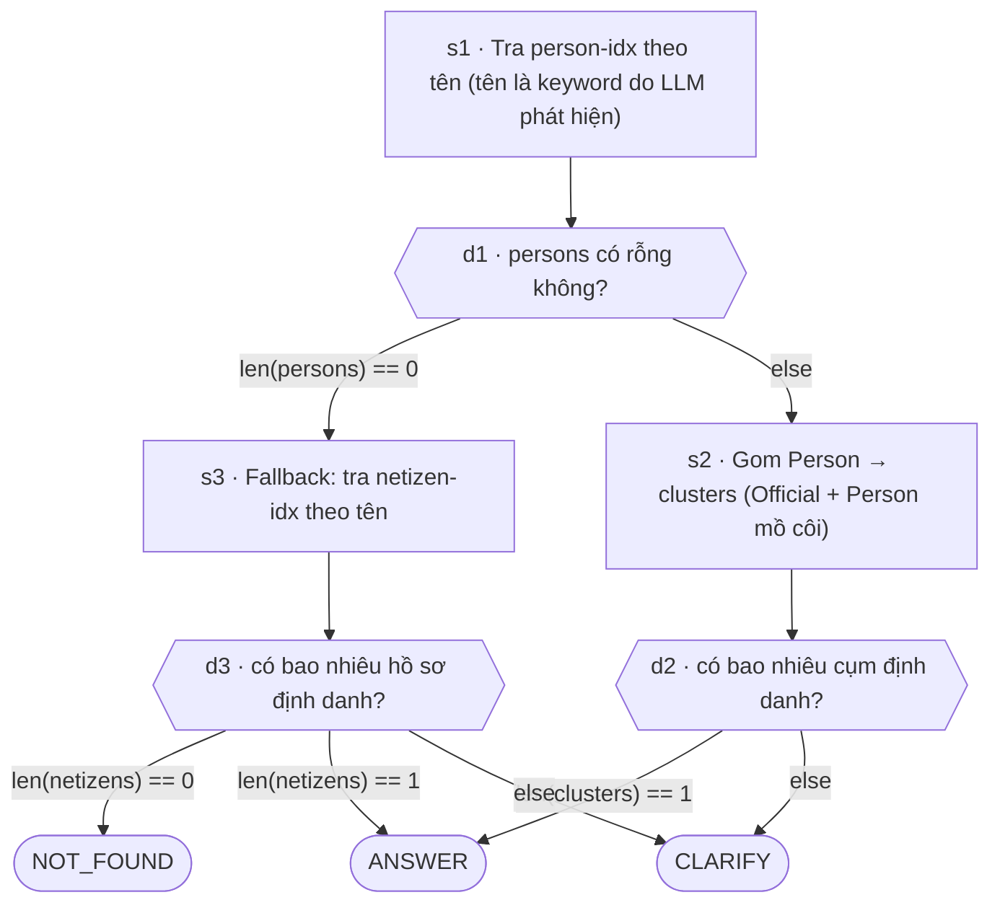
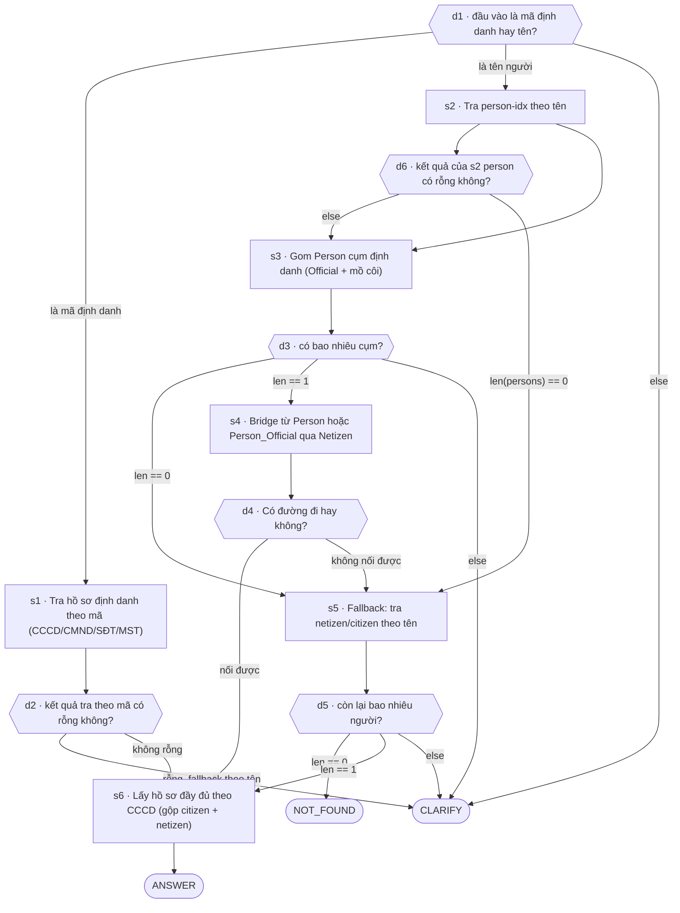

# Capabilities

Khi nhận câu hỏi người dùng thì luồng hoạt động của Agent sẽ như sau:

Chi tiết các **Plan** của từng cap sẽ được viết ở dưới.

## 1. Tra cứu thông tin công khai người theo tên

### Description

Người dùng hỏi một người là ai / làm gì (thường là người có thông tin công khai trên mạng).
Ưu tiên dữ liệu công khai (Person -> Person_Official).

group: identity
anchor_types: [person_name, description]
required_slots: [person_query]

### Example utterances

- Nguyễn Văn A là ai?
- Người có tên là Nguyễn Văn A là ai?
- Cho tôi biết thông tin của Nguyễn Văn A?
- Đỗ Văn C làm gì?
- Người tên Đỗ Văn C có công việc gì?
- Đỗ Văn C có nghề nghiệp như nào?
- Thông tin công khai của Nguyễn Văn A
- Đỗ Văn C có những hoạt động gì?

### Plan

- Step (s*): là một bước trong một plan thực hiện capability, trong mỗi s* có tool, đầu vào đầu ra, mô tả.
- Decision (d*): bản chất không chưa tool, chỉ rẽ nhánh để biết tại một step thì đi tiếp đến đâu.
- Terminal: ANSWER | CLARIFY | NOT_FOUND (phân loại đầu ra của plan)

### Answer policy

Phần này giúp LLM trả lời đúng hướng hơn từ quyết định Terminal của  Plan:

- ANSWER: Khi d2 có đúng một cụm định danh có nghĩa là chỉ có 1 Person_Official hoặc 1 Person mà không có relation đến Person_Official thì sẽ lấy dữ liệu trả lời người dùng. Ngoài ra khi fallback sang Netizen mà xảy ra trường hợp chỉ có 1 netizen trả về (Hiếm) thì cũng sẽ trả lời câu hỏi.
- CLARIFY: Khi có nhiều cụm định danh có nghĩa là có nhiều Person_Official hoặc nhiều Person không tìm thấy relation với Person_Official thì cần liệt kê một lượng nhỏ bản ghi kết hợp với hỏi lại user
- NOT_FOUND: persons và netizen đều rỗng thì nên trả lại không tìm thấy thông tin không suy đoán.

## 2. Tra cứu hồ sơ định danh của người.

### Description

Người dùng hỏi thông tin cá nhân của một người theo **tên** hoặc **số CCCD, CMND, SĐT, ...**, có thể phải trả về ngày sinh, địa chỉ, quê quán, dân tộc, tình trạng hôn nhân, số điện thoại, ...

- anchor_types: [person_name, cccd]
- required_slots: [person_name | cccd, cmnd]
- optional_slots: [attribute]

### Example utterances

- Nguyễn Văn A sinh năm bao nhiêu?
- Thông tin định danh của Nguyễn THị A
- quê quán và dân tộc của bà Phạm Thị Thanh
- số CCCD của ông Nguyễn Văn Ninh
- Nguyễn Văn A đã kết hôn chưa
- ....

### Plan

### Answer policy

**ANSWER** — đã xác định đúng một người và có hồ sơ. Trả **thẳng** thông tin được hỏi (ngày
sinh, quê quán, dân tộc, hôn nhân, SĐT...). Nếu người dùng không nói rõ hỏi mục nào → tóm tắt
hồ sơ cơ bản. Thông tin được hỏi mà hồ sơ **không có** → nói rõ "hệ thống không có thông tin
này", KHÔNG suy đoán.
 
**CLARIFY** — còn nhiều người trùng tên. Liệt kê tối đa 3 người kèm thông tin phân biệt (năm
sinh, vài số cuối CCCD, quê quán) rồi hỏi người dùng muốn ai. KHÔNG gộp thành một người, KHÔNG
tự chọn.
 
**NOT_FOUND** — không tìm thấy hồ sơ nào. Trả: "Không tìm thấy hồ sơ định danh cho người này."
KHÔNG suy đoán.

