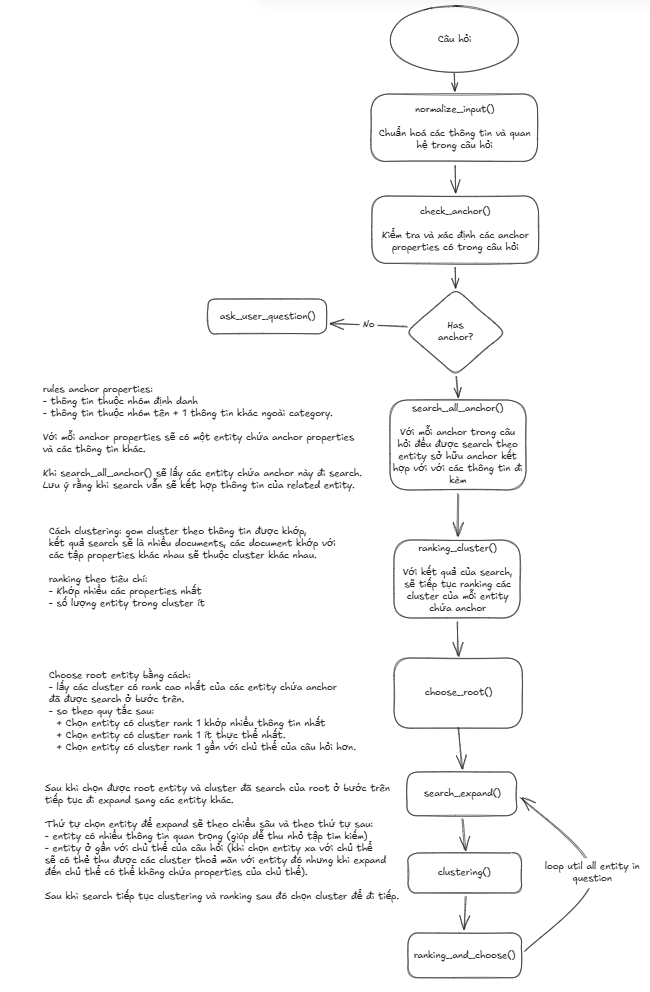
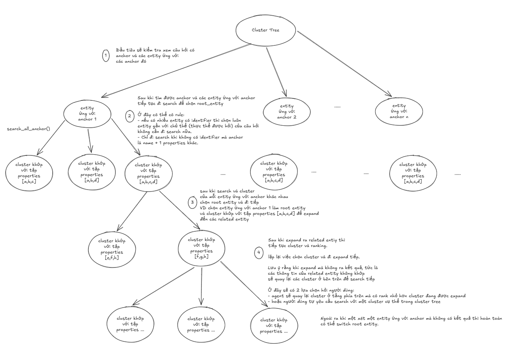

Có 2 skills đó là:
- `es-data-explorer`: Giúp agent hiểu được dữ liệu cần tra cứu và phân tích
- `es-lookup-pipeline`: Đây là skills tra cứu giúp xác định một thực thể

Lý do cần chia ra 2 skills vì ngoài skill `es-lookup-pipeline` sử dụng để tra cứu xác định thực thể thì có nhiều hướng khai thác dữ liệu khác. Ví dụ phân tích tổng hợp dữ liệu: "Người dùng hỏi phân phối số lượng người dân sinh sống tại Việt Nam"  thì agent có thể vẽ biểu đồ thể hiện số lượng phân phối người dân tại các khu vực hoặc các tỉnh và đưa ra kết luận (có thể đóng thành 1 skill phân tích)

Trước tiên đi triển khai phần tra cứu:

Dưới đây là flow của skill

Tiếp theo là cấu trúc dữ liệu xuyên suốt được sử dụng:

